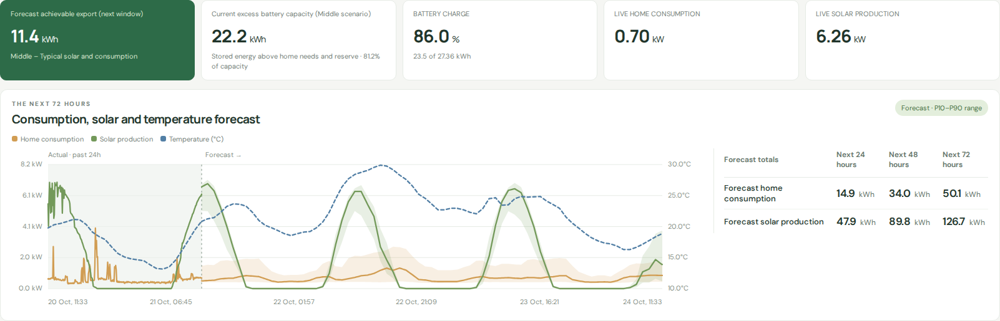
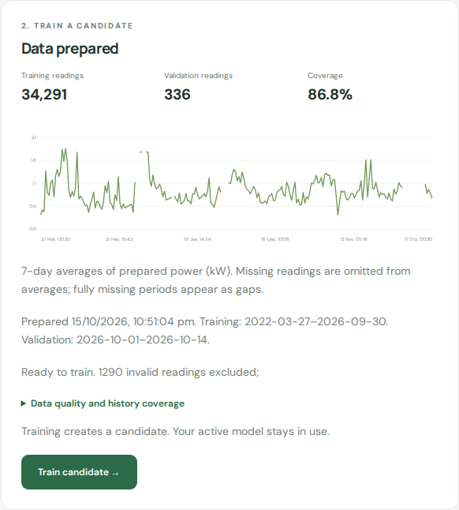
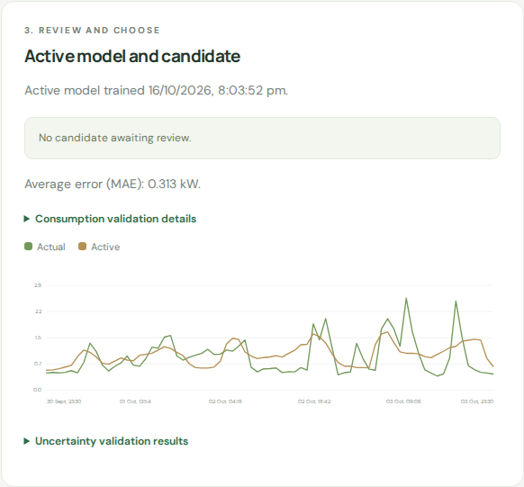
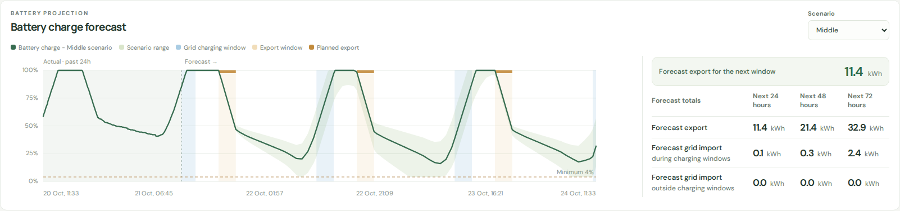
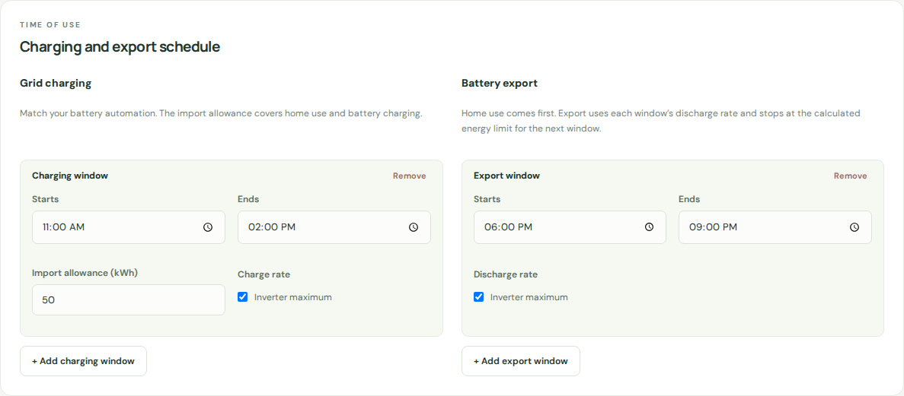

# ToU Discharge Forecaster

**Forecast your home’s energy needs. See what your battery can export.**

[](https://github.com/funkmaster-dan/evening-energy/releases)
[](https://www.python.org/)
[](LICENSE)

ToU Discharge Forecaster is a local web app for homes with solar, a battery and a time-of-use electricity tariff. It learns from Home Assistant history, combines consumption and solar forecasts with weather, and projects battery charge across your charging and export schedule.

Its two key numbers answer different questions: **how much stored battery energy is spare**, and **how much energy can actually reach the grid in the next export window**.

The app forecasts and reports. **It never sends commands to your battery.**



*Screenshots show actual readings and model results from a local Podman instance using a private copy of deployment data. Location, maps, connection details and sensor identifiers are outside the captured areas. These are example outcomes for one installation, not performance guarantees.*

## What’s in the app

| Page | What you can do |
| --- | --- |
| **Overview** | See live consumption, solar production and battery charge; compare forecasts, export allowances and battery trajectories. |
| **Models** | Prepare recorded history, train a candidate, inspect data quality and validation results, then decide whether to use it. |
| **Settings** | Connect Home Assistant, select sensors, place your home on a map, configure panel banks and battery limits, and manage charging/export windows. |

- **Consumption and solar forecasts:** separate LightGBM models for home use and each solar panel orientation, with P10/P50/P90 hourly uncertainty estimates.
- **Weather on the chart:** temperature uses its own °C axis alongside consumption and solar in kW. Hover or tap to inspect aligned power and battery forecasts.
- **Battery planning:** calibrated charge/discharge and inverter efficiencies, usable capacity, minimum charge, an additional reserve, and scheduled grid charging.
- **Multiple daily windows:** separate charging and export windows, including overnight windows and optional custom power rates.
- **Local storage and training:** settings, recorded history, prepared datasets and trained models stay in your mounted data directory. Forecasts use Home Assistant and external weather/calendar services.
- **Home Assistant reporting:** the separate [Energy Excess integration](https://github.com/funkmaster-dan/ha-energy-excess) exposes the results as sensors for dashboards and your own automations.

## Get running

You need Docker with Compose, a reachable Home Assistant instance and internet access for weather/calendar data and the initial build. A CPU is sufficient; no GPU is required.

```bash
git clone https://github.com/funkmaster-dan/evening-energy.git
cd evening-energy
docker compose up -d --build
```

Open **[http://localhost:8099](http://localhost:8099)**. For an installation on another machine, use that machine’s address.

The included Compose file mounts `./data` at `/data` and sets a sample timezone. Set `TZ` to your timezone and select the matching timezone in the app. With Podman and `podman-compose`, the equivalent command is:

```bash
podman-compose up -d --build
```

### 1. Connect and configure

Open **Settings**:

1. Create a Home Assistant **long-lived access token** from your user profile. Enter your HA URL and token, save, then use **Check saved connection**.
2. Select live home consumption, battery charge/discharge power, battery state of charge, and solar output sensors. Select consumption history sources separately if a sensor has been replaced.
3. Set your location using the map or latitude/longitude fields. Choose your timezone, Australian state or territory, weather model and forecast length, up to **72 hours**.
4. Enter usable battery capacity, charge/discharge limits, minimum state of charge and additional reserve.
5. Add one solar bank per panel orientation, selecting its production sensor, azimuth and tilt. Panel capacity is estimated during calibration.
6. Configure charging and export windows to match your tariff and battery automation, then **Save settings**.

The map supports clicking and dragging the marker; coordinate fields remain available if the map cannot load. Sensor checks distinguish live inputs from history-only sources and recognize unavailable solar readings at night. A connection check confirms access to HA; review the sensor checks as well.

Defaults are examples. Replace them with your own sensors, battery specifications and schedule.

### 2. Prepare history and train

Open **Models** and select home consumption, a solar bank, battery efficiency or solar inverter efficiency:

1. Choose separate training and validation dates and check the selected sensors. Suggestions use recent recorded history; saved dataset dates are retained when you return to a model.
2. Click **Prepare data**. Review coverage, the prepared-history chart and **Data quality and history coverage**.
3. Click **Train candidate**. Your active model continues to be used.
4. Review the candidate’s errors and measured-versus-predicted chart. Where a compatible active model exists, both are compared on the same validation periods.
5. Choose **Use candidate** to activate it, or **Delete candidate** to keep the active model. The first model also requires explicit activation.

Repeat for consumption, each solar bank, battery efficiency and inverter efficiency. The app keeps one active model and one pending candidate per model; resolve a candidate before training another.





Start with at least **seven training days and four validation days** for consumption. More history is useful for seasonal behavior; the interface recommends a year or more where available, with 28–56 recent days held out for validation. Battery calibration needs five-minute readings covering both charging and discharging. Readiness depends on usable readings and complete forecast windows, not just date-range length.

### Choosing the right sensors

| Input | What to select |
| --- | --- |
| **Live home consumption** | Whole-home power in W or kW. Grid import and cumulative kWh totals are different measurements. |
| **Consumption history** | The same home-use measurement, optionally extended with older replacement sensors, ordered oldest first. History-only sources do not need a current live state. |
| **Solar bank production** | PV power for that orientation. Choose individual string sensors or their combined sensor without counting both. |
| **Battery I/O power** | One signed charge/discharge power sensor in W or kW. Calibration determines the sign convention. |
| **Battery state of charge** | Charge percentage for the same battery. Capacity must describe the usable energy represented by this sensor. |
| **Solar output / AC monitoring** | Independent solar AC or CT power when available. If using PV production as a proxy, select the proxy option; inverter calibration and achievable export are approximate. |

Battery and inverter preparation show sensor roles explicitly. Select battery power and charge percentage for battery calibration, and PV inputs plus solar output for inverter calibration. Avoid an inverter total-output sensor that includes battery discharge when measuring solar AC production.

For changed or removed panels, set the bank’s **Production history starts** date to the beginning of the current layout. Earlier readings are excluded for that bank.

## Read the forecast

### Battery excess and achievable export

| Metric | Meaning |
| --- | --- |
| **Battery excess** | Stored battery energy above forecast home needs, minimum charge and reserve. It is not limited by the export window’s duration or power cap. |
| **Achievable export** | AC energy that can reach the grid in the current or next export window, after losses, home demand, discharge power and time limits. It can include charging expected before a future window. |

A large excess can coexist with a smaller achievable export. The battery may have spare energy but too little time or inverter power to deliver all of it.

### Choose an energy scenario

Use the battery chart’s **Scenario** selector or click a row under **Export scenarios**. The headline energy metrics follow your selection.

| Scenario | Solar energy | Home consumption energy |
| --- | --- | --- |
| **Conservative** | Lower: P10 | Higher: P90 |
| **Middle** | Typical: P50 | Typical: P50 |
| **Optimistic** | Higher: P90 | Lower: P10 |
| **No export** | Middle scenario | Middle scenario, with export disabled |

Energy targets come from complete sampled forecast paths for local **06:00–18:00** and **18:00–06:00** blocks. Partial blocks use only the covered forecast hours. Each scenario follows the forecast’s hourly shape, scaled to its block energy targets, with no solar production during darkness. Expand **Day and night energy totals** for the targets and covered periods.



The battery chart shows the selected scenario’s charge trajectory, minimum charge, additional reserve and export periods. Its shading compares the three energy scenarios **at the selected export allowance**; it is a scenario range, not a probability interval. The power chart’s P10–P90 shading describes hourly consumption and solar uncertainty separately.

Export planning checks the **entire configured forecast horizon**. It seeks an allowance that preserves minimum charge plus reserve and avoids household grid imports beyond configured charging allowances. If those conditions cannot be met without export, the scenario reports zero allowance. Time, power limits, reserve or a later low point can leave the battery above minimum charge the next morning.

### Charging and export schedules



In **Settings → Charging and export schedule**:

- Add one or more daily windows to either column. Start/end times may cross midnight.
- A charging window’s **Import allowance (kWh)** covers both home use and battery charging.
- **Inverter maximum** uses the configured battery charge or discharge limit. Untick it to enter a custom rate for that window; the battery’s configured maximum still caps the rate.
- Planning uses the **first current or upcoming export window** within the forecast. It does not optimize a whole day’s exports across every window.
- Home use takes priority during export. Export stops when its calculated energy allowance is reached or the window ends. Scenarios change the energy allowance; they use the same configured window rate.

These windows describe expected behavior. Your battery controller or Home Assistant automations must perform the actual charging and exporting.

## Report to Home Assistant

Install [Energy Excess](https://github.com/funkmaster-dan/ha-energy-excess) through HACS, then add the integration with this app’s URL.

It provides **twelve derived sensors**: conservative/middle/optimistic battery excess and achievable export, each in kWh and battery percentage. Attributes identify the energy basis and readiness. Unavailable inputs or incomplete calibration produce zero allowances with `ready: false`; expired forecasts also return zero allowances. An unreachable app or expired forecast makes the integration’s sensors unavailable.

An [optional export automation example](home_assistant/README.md) shows how to use the forecasts with a compatible controller. Check its entity IDs, timing and discharge assumptions against your installation.

For custom consumers, the app exposes:

| Endpoint | Purpose |
| --- | --- |
| `GET /api/health` | Service status and deployed source revision. |
| `GET /api/excess` | Allowances, scenario inputs, readiness and export policy without the full chart data. |
| `GET /api/forecast` | Complete forecast and battery projections. |

`low`, `middle` and `high` identify conservative, middle and optimistic scenarios. They do **not** mean percentiles of achievable-export outcomes. Read the readiness, validity and energy-basis fields alongside numeric values.

## Models, uncertainty and data quality

Home consumption and each solar bank use separate LightGBM models. Consumption learns weather, Australian calendar patterns and measured context available before forecast issue time. Solar learns weather and bank-specific tilted irradiance with sun position and lead-time features. A selected point estimate drives consumption totals; separate P10/P50/P90 heads supply uncertainty.

Calibration uses chronological fitting and validation, including issued-weather replays where supported. Review energy errors as well as hourly errors. Historical comparisons are retrospective evidence; training alone does not establish better future accuracy.

The sampler combines the marginal heads into complete hourly paths and estimates block energy quantiles. It preserves asymmetric bounds and solar darkness, with learned temporal persistence where available and assumed cross-bank cloud correlation. New installations default to **5,000 uncertainty samples**; existing saved settings remain in use. More samples reduce numerical sampling variation, not model error. Adding hourly P90 values does not produce a P90 daily total.

Preparation retains source coverage and missing periods. Consumption gaps remain empty. Fully dark missing solar intervals can become derived zeros; limited daylight interpolation is tracked separately and receives reduced fitting weight. Invalid and corroborated frozen readings are rejected. Expand the quality and validation details in **Models** to inspect coverage, exclusions, energy errors and uncertainty diagnostics.

## Run and maintain

### Without a container

Use Python **3.12**:

```bash
python -m venv .venv
source .venv/bin/activate
pip install -r requirements.txt
uvicorn app.main:app --host 0.0.0.0 --port 8099
```

`ENERGY_DATA_DIR` selects the private data directory; the default is `data/`. Training uses two LightGBM threads by default, configurable with `ENERGY_TRAIN_THREADS`.

### Update or inspect the service

```bash
git pull
docker compose up -d --build
docker compose logs --tail=100
```

Your mounted `data/` directory survives container rebuilds. It contains credentials, settings, sensor history, prepared datasets and trained models: keep it private and preserve it when moving installations. No household dataset or pretrained model is distributed in this repository.

Existing installations migrate the old single export window to the window list. Saved settings remain in use. Model readiness checks determine whether a stored model is compatible; prepare replacement data and train a candidate when the interface requires it.

### When something needs attention

| Symptom | Check |
| --- | --- |
| **No usable allowance** | Activate all required models, confirm current battery charge and HA connectivity, and inspect forecast readiness/warnings. |
| **Zero export with a charged battery** | Compare scenarios, reserve, expected home needs, next export window, discharge rate and charging allowance across the full horizon. |
| **Missing or wrong-unit sensor** | Save Settings and inspect sensor status. Match power inputs to W/kW and SoC to %. History-only sources are handled separately. |
| **Training disabled** | Check dataset readiness, complete validation coverage, a running job or an unresolved candidate. |
| **Gaps or implausible solar history** | Review quality exclusions, panel-layout start dates, source coverage and selected sensor units. |

## Scope and dependencies

This is an experimental home project. Results depend on your installation, recorded history, weather and configured assumptions. Scenario labels and uncertainty bounds are estimates, not guaranteed battery outcomes.

Run the app on a **trusted private network**. It has no user authentication, and the Home Assistant token is stored in the private data directory. Do not expose the service directly to the internet.

Weather and tilted irradiance come from [Open-Meteo](https://open-meteo.com/); sun position uses [pvlib](https://pvlib-python.readthedocs.io/). Australian calendar features use [python-holidays](https://holidays.readthedocs.io/), [AustralianHolidays school calendars](https://github.com/pmcau/AustralianHolidays) and bundled historical school dates. The optional location map uses Leaflet and OpenStreetMap tiles.

## License

[MIT](LICENSE). See the [changelog](CHANGELOG.md) for the v1 release overview.
